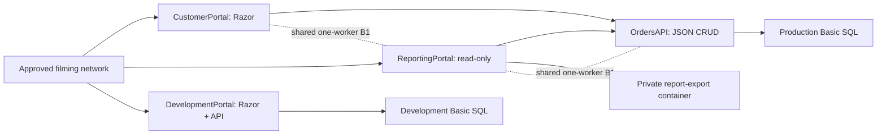

# Architecture and reuse

The selected sample is
[`Azure-Samples/msdocs-app-service-sqldb-dotnetcore`](https://github.com/Azure-Samples/msdocs-app-service-sqldb-dotnetcore/tree/7538f5b5260151e1c7ec75060705f923c61cacb9),
pinned at `7538f5b5260151e1c7ec75060705f923c61cacb9`.
It supplies real Razor list/create/delete forms, EF SQL persistence and migration
history, not merely a landing page. Inspecting that source is not evidence that
this adaptation has run successfully. The alternative archived React/C# todo,
expensive App Service baseline, and archived zone-redundant infrastructure-only
sample are not copied.

| Resource group | Resources |
|---|---|
| `rg-finops-production` | CustomerPortal, OrdersAPI, ReportingPortal; SQL logical server + Basic orders DB; three workspace-linked Insights components; API metric alert |
| `rg-finops-development` | DevelopmentPortal; dedicated Linux B1 plan; separate SQL server + Basic orders DB; Insights; plan metric alert |
| `rg-finops-shared` | Production Linux B1 plan; shared 30-day PAYG Log Analytics; Hot ZRS Blob account; email action group; plan metric alert; container-scoped report role assignment |

Exactly four apps, two plans, two SQL servers/databases, four Insights, one
workspace and one storage account. Subscription-scoped budgets additionally
filter the Project tag or exact resource group. Their placement does not mean
four extra billable resources.

`IOrdersService` extracts upstream database operations. SQL services exist only
in API/development roles. Production portals register the typed HTTP adapter and
no EF context; failed HTTP calls return explicit errors, never empty success or
a database fallback. Controller discovery excludes other roles' surfaces.
Razor mutations and report exports retain anti-forgery tokens. Server-side HTTP
avoids a new SPA, broad browser CORS or browser token architecture.

Created/updated UTC timestamps, validated category/status and 30 fictional service
requests make real CRUD/reporting possible. Seed rows use reserved descriptions
`[Contoso seed NN] ...`; repeat seeding inserts only missing rows and never
clears/overwrites existing orders. CSV quotes commas, newlines and quotes, and
neutralizes spreadsheet-formula prefixes. Lists/CSV are bounded to 200 recent
orders; aggregate counts cover all records. No payments or real customer data.

## Provisioning and identities

AVM pins: `web/serverfarm:0.7.0`, `web/site:0.24.0`, `sql/server:0.23.0`.
The exact published interfaces were inspected. Premium/three-worker and SQL
zone-redundancy defaults are explicitly overridden. Optional AVM telemetry is
off. Remaining small configuration resources use native Bicep.

Core deployment closes app/SCM ingress. Network access is a separate RG-scoped
Bicep operation using reviewed current configurations and possible outbound IPs.
Main-site rules allow approved development/filming CIDRs and API portal egress;
SCM rules allow only approved administrator CIDRs. SQL permits only the relevant
app egress and temporary administrator IPv4. No `/0`, Azure-wide SQL firewall,
private endpoint, VNet, WAF or Gateway is silently introduced.

Azure app settings enable the standard ASP.NET Core forwarded-header integration
for App Service's TLS-terminating front end; local launch profiles do not enable
it. Production anti-forgery cookies require HTTPS. Platform health routes avoid
application redirects while App Service still enforces public HTTPS and ingress
rules. Verify forwarded scheme, cookies and health probes in the live trial.

Incremental ARM deployment does not delete omitted firewall rules. The bootstrap
rule is retained but explicitly disabled at `255.255.255.255` after initialization,
not silently omitted. Obsolete/unexpected app-egress rules cause the script to
stop for reviewed explicit removal. Reconcile outbound IP changes before filming.
Repeated full core deployment resets site ingress to closed; use the Network
phase again. Development resizing targets only the plan wrapper and CPU alert,
not root/app/network resources.

OrdersAPI and DevelopmentPortal use system-assigned managed identities to their
respective SQL databases. ReportingPortal uses its identity only for the
report-export Blob container. CustomerPortal has no identity or SQL connection.
SQL is Entra-only, with a separately supplied group administrator. Initialization
uses the explicitly signed-in administrator through Active Directory Default,
runs reviewed EF migrations, creates external-provider contained application users and
grants table CRUD only. Runtime never gets `db_owner`, schema-change rights or
access to the other DB. No automatic Directory Readers grant is made.

Managed identity provisioning and data-plane SQL grants are separate operations;
Bicep/RBAC alone cannot establish database users. Verify tenant permissions and
directory resolution in the authorized live trial. The script resolves the
managed identity service principal read-only and verifies its object ID, display
name and application/client ID. SQL stores the application/client ID in the
external service-principal user's SID, not its Entra object ID. Existing and
new users are checked against that client ID before table grants. Directory
lookup permission is a real precondition; failures stop without automatic role
grants. The normal unique app display-name path uses `FROM EXTERNAL PROVIDER`;
ambiguous-name errors require reviewed identity resolution rather than guessing.
See [Microsoft's identity/SID distinction](https://learn.microsoft.com/en-us/sql/relational-databases/security/authentication-access/authentication-microsoft-entra-create-users-with-nonunique-names).
Do not replace
managed identity with a password when that trial reveals a provisioning issue.

## Tags and allocation

Central tags: `Environment`, `Application`, `Owner`, `CostCentre`,
`Project=ContosoFinOpsDemo`, `ManagedBy=Bicep`. Shared plan:
`Environment=Shared`, `Application=SharedAppHosting`,
`WorkloadEnvironment=Production`. Apps/Insights/SQL DBs retain their own workload
tags. Resource groups and taggable resources receive explicit maps.

Tags do not automatically inherit from resource groups. SQL master/admin/firewall/
backup policy children, app configs/publishing policies, diagnostic settings,
budgets, role assignments and Blob configuration children are documented
exceptions. [Microsoft tag support](https://learn.microsoft.com/en-us/azure/azure-resource-manager/management/tag-support)
varies by resource type. Cost Management tag inheritance affects eligible usage
records, not ARM resource metadata; verify agreement/scope eligibility and retain
resource-tag precedence.

Per-app tags do not divide shared plan charges. The approved chargeback policy
allocates production plan compute 40% CustomerPortal, 40% OrdersAPI, 20%
ReportingPortal. Keep raw and allocated reports separate and reconcile totals.

## Honest resilience limits

One B1 worker has no zone redundancy or hot failover. Health checks detect/
recover failure but do not keep service uninterrupted with a second healthy
worker. Basic SQL is 5 DTU/max 2 GB and not zone redundant. Production GRS PITR
backups are recovery protection, not a live replica or automatic failover.
ZRS report storage does not make the estate zone resilient.

Genuinely zone-resilient App Service needs an eligible Premium/stamp deployment,
at least two workers and compatible scaling configuration; zone-resilient SQL
requires a supported higher tier. The Stage 1 P0v3 two-worker web-only estimate
already exceeds GBP 100 including VAT, before SQL and other services.
This lab is an affordable operational demonstration, not that production design.

References: [App Service hosting/billing](https://learn.microsoft.com/en-us/azure/app-service/overview-hosting-plans),
[zone redundancy](https://learn.microsoft.com/en-us/azure/app-service/configure-zone-redundancy),
[SQL identity](https://learn.microsoft.com/en-us/azure/app-service/tutorial-connect-msi-sql-database),
[Basic limits](https://learn.microsoft.com/en-us/azure/azure-sql/database/resource-limits-dtu-single-databases?view=azuresql).
